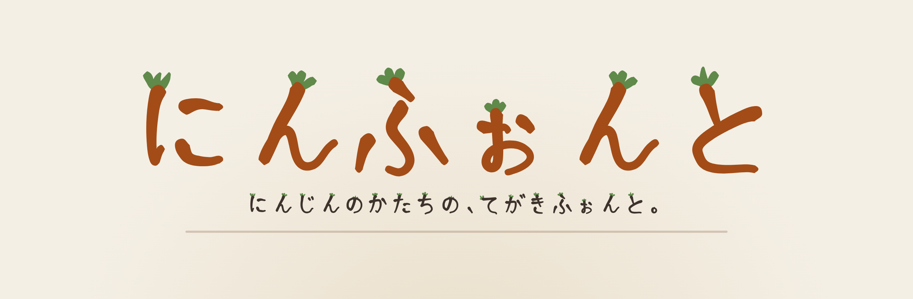
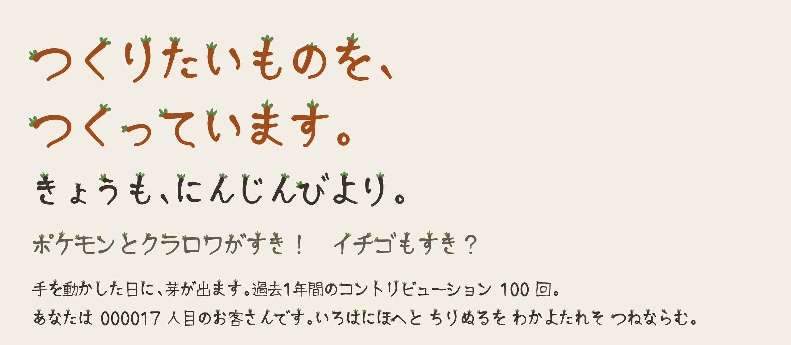
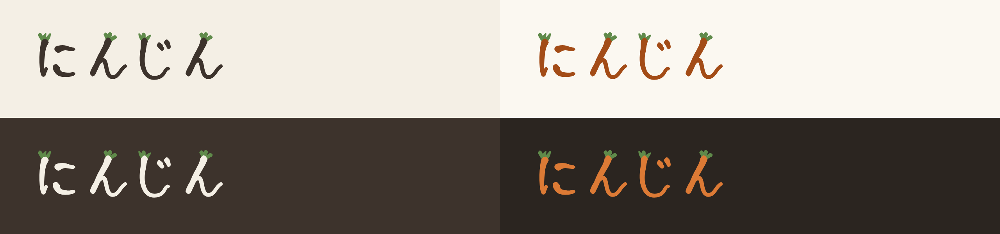
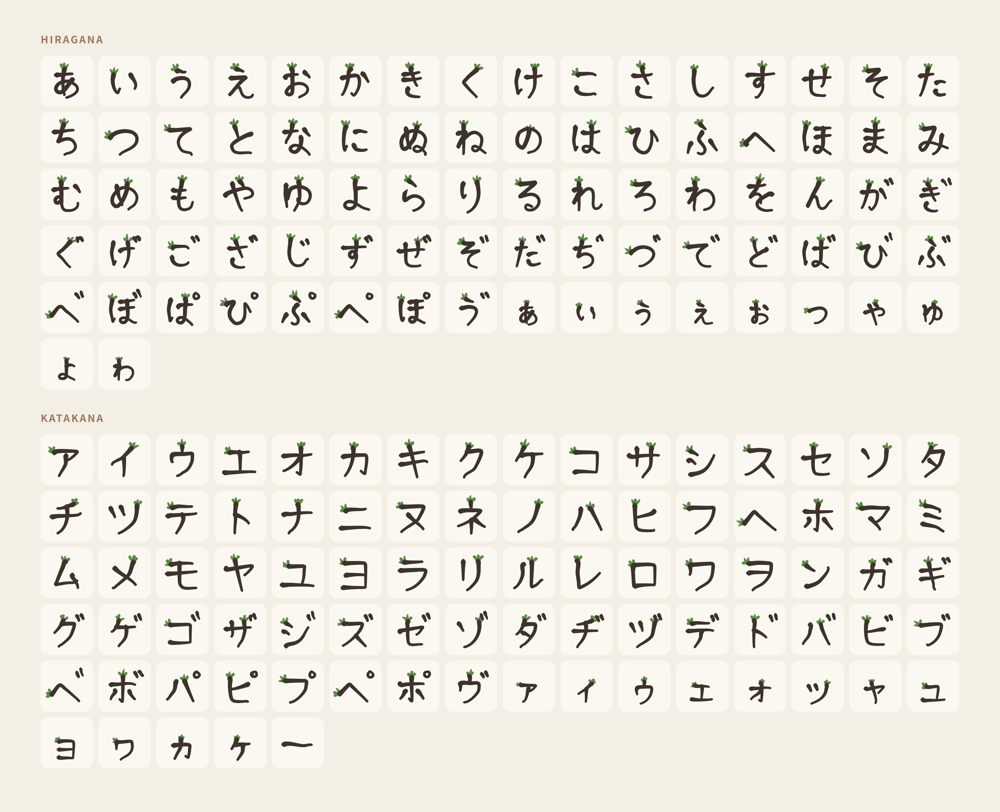
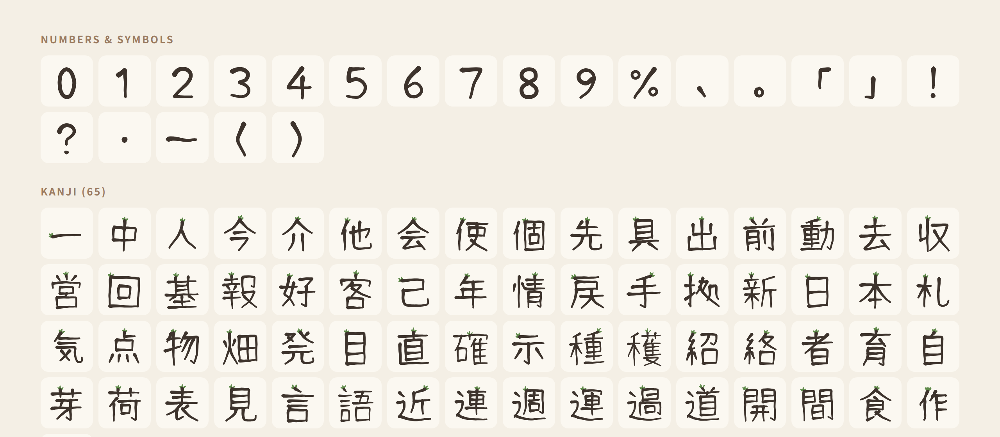
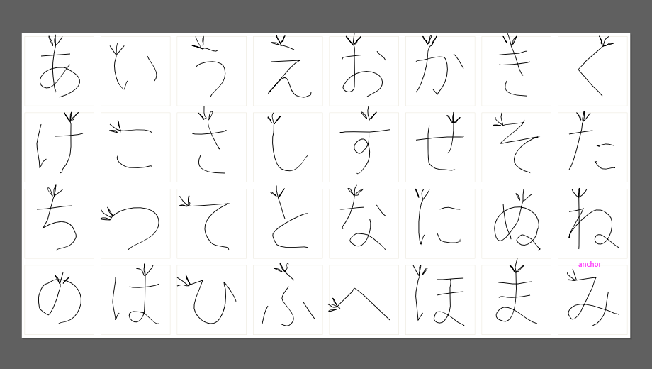

<p align="center">
  
</p>

<p align="center">
  
  
  
  <a href="LICENSE"></a>
</p>

# にんふぉんと

**にんふぉんと（Ninfont）** は、にんじんの形をした手書きのフォントです。
どの線も書き始めが丸く太く、先に向かって少し細くなります。文字のてっぺんには、葉っぱが3枚生えています。

個人サイト [2nj.lol](https://2nj.lol/) の見出しや名前のために作りました。

<p align="center">
  
</p>

## とくちょう

| | |
|---|---|
| 🥕 **にんじんの線** | 頭が丸くて太く、先が細い。角はまるめて、やわらかい手書きの線にしています。 |
| 🌱 **葉っぱつき** | 文字のいちばん上の書き始めに葉が3枚。数字と記号には付きません。 |
| 🎨 **葉だけ緑** | 色つきフォント（COLR）です。葉は緑のまま、本体は文字色に合わせて変わります。 |
| ✍️ **手で描いた線** | ひらがな・カタカナは、ベクター描画ソフトの鉛筆ツールで1画ずつ描いた線がもとです。 |

### 文字の色を変えても、葉は緑のまま

<p align="center">
  
</p>

## 収録している文字

全部で 252 文字です。

- ひらがな・カタカナ（濁音、半濁音、小さい字を含む）
- 数字 `0`〜`9`
- 記号 `、` `。` `「` `」` `！` `？` `・` `ー` `%` `（` `）`
- 漢字 65 字（[2nj.lol](https://2nj.lol/) に出てくる字だけ）

英字と、ここに無い漢字は入っていません。ほかのフォントと重ねて使ってください。

<p align="center">
  
</p>

<p align="center">
  
</p>

## つかいかた

### パソコンに入れる

[`fonts/Ninfont.otf`](fonts/Ninfont.otf) をダウンロードして開き、インストールします。
フォント名は「にんふぉんと」（英語名 `Ninfont`）です。

### Web ページで使う

```css
@font-face {
  font-family: "Ninfont";
  src: url("/fonts/Ninfont.otf") format("opentype");
  font-display: swap;
}

h1 {
  /* にんふぉんとに無い文字は、うしろのフォントで表示されます */
  font-family: "Ninfont", "Hiragino Maru Gothic ProN", sans-serif;
  color: #a34c17; /* 本体の色。葉は緑のまま */
}
```

> [!NOTE]
> 葉の色分けには、色つきフォント（COLR v0）に対応した環境が必要です。動作を確かめたのは Chrome だけです。
> 対応していない環境では、葉も文字と同じ色で表示されます。

大きめの文字（見出し、名前、ロゴ）で使うのがおすすめです。小さい文字では、葉が緑の点のように見えます。

## つくりかた

<p align="center">
  
</p>

1. **骨格を決める** — 文字ごとの中心線を [`src/glyphs.py`](src/glyphs.py) に書きます。濁点つきや小さい字、漢字の偏やつくりは、部品を使い回します。
2. **線を描く** — ひらがな・カタカナは、骨格を少し揺らしながら、ベクター描画ソフト（VectorCraft）の鉛筆ツールで1画ずつなぞって描きました（[`work/sheet-1.svg`](work/sheet-1.svg)〜`sheet-6.svg`）。漢字と数字は、骨格から直接線にしています（`sheet-7.svg` 以降）。
3. **にんじんの形に肉付けする** — [`src/build.cjs`](src/build.cjs) が、線に太さを付け、角をまるめ、葉と本体を別の層に分けて、フォントのファイルに組み立てます。

### 自分で組み立てる

Node.js と Python 3 が必要です。

```sh
npm install --no-save opentype.js@1.3.4 paper@0.12.17
node src/build.cjs          # fonts/Ninfont.otf ができます（1〜2分）
```

太さ、細り方、葉の形、葉の色は `src/build.cjs` の中の値で変えられます。

漢字や数字の骨格を足したときは、先に線のシートを作り直します。

```sh
cd src && python3 direct.py 7 8 9
```

## フォルダ

```
fonts/   できあがったフォント
src/     骨格の定義と、組み立てのスクリプト
work/    もとになる線（SVG）と、どの線がどの文字かの一覧
docs/    この README の画像
```

## ライセンス

[CC BY 4.0](https://creativecommons.org/licenses/by/4.0/deed.ja)（クリエイティブ・コモンズ 表示 4.0 国際）です。全文は [`LICENSE`](LICENSE) にあります。

作者名を表示すれば、商用でも、改変しても、配り直しても自由に使えます。

```
にんふぉんと © にんじん (https://2nj.lol/) — CC BY 4.0
```

フォントのファイル、もとの線、画像、スクリプトのすべてが対象です。

---

<p align="center">つくった人: <a href="https://2nj.lol/">にんじん</a></p>
